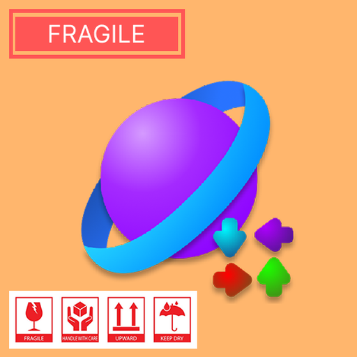

    
    <h1>SolarLanDroid</h1>
    Finally, an FNF launcher for Android!

A FNF Launcher for Android and based of Solar Launcher! Seperate codebase, same functionalities, but less features. You can do exactly what you want in SLDesktop to SLDroid! ... *just with a little less features*

> [!NOTE]
> Shizuku parts of the code is assisted with AI. It wouldn't be possible without it, and SLD wouldn't even have it's listed functionality about it.

## Requirements
You will need to use [Shizuku](https://shizuku.rikka.app/) **If you are using Android version 11 and above**. Android has heavily restrct apps interacting with your folders, so this is the best way to interact with your file system.

## Features
### Mod Manager
Manage your mods easily with one dialog. You can enable/disable, delete, and open folder through the dialog, just like how you'd do in SLDesktop!

### Deeplinks support
Easily download and import GameBanana mods with the deeplink feature. Just go to GameBanana, and click on Solar Launcher and it'll automatically open Solar Launcher and let you pick what you want to download!

### Native-feel UI
Using Material Design 3, we are able to achieve Material Design 3's UI! Feels right at home with SLDesktop, and you know what the design is automatically.

## Planned Features
Here are planned features we are planning to add in the future, to make managing mods easier for you!

### In-app Engine Downloading
From a GitHub repository, you can download the latest release assets and select the `.apk` file. It'll be automatically put in your Downloads folder, and (hopefully, we can implement this) prompt you to install it.

### Better Error Handling
Right now, error handing doesn't give you which error it is. So, we're making our own error handler to tell what action, reason, logs, you were doing! You can copy it for Discord, send it in the support channel, and we can help assist you!